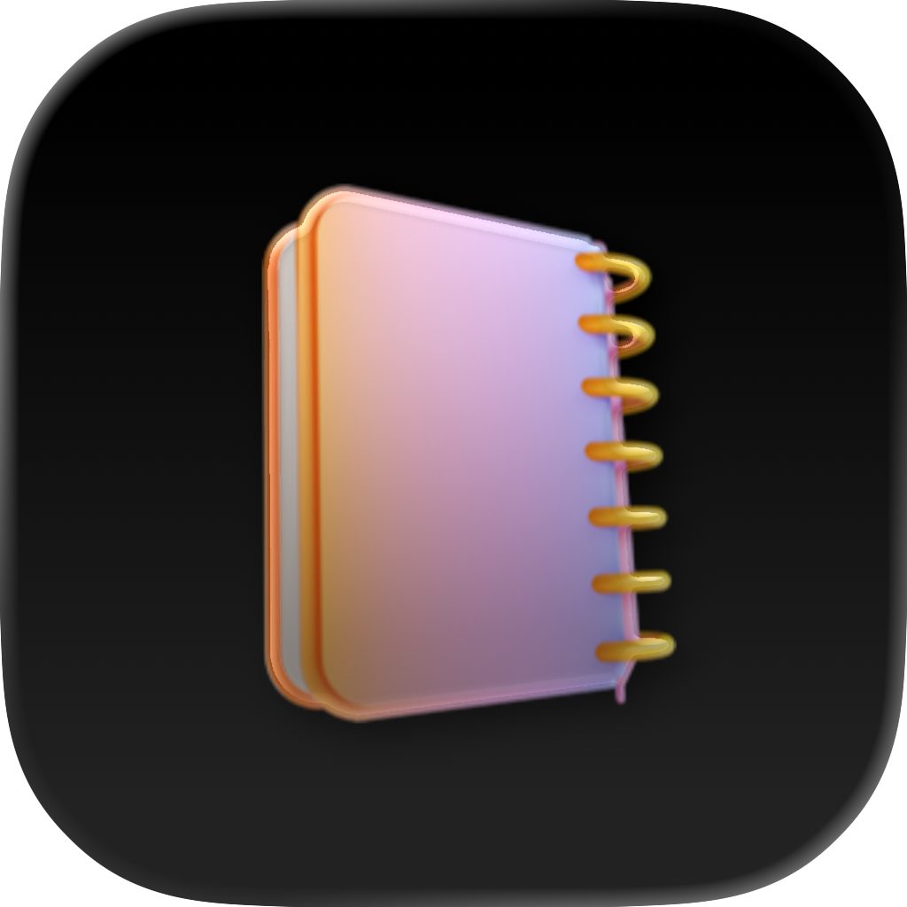
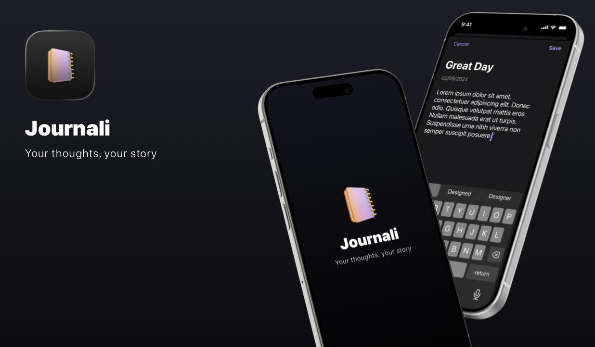

  

<h1 align="center">Journali</h1>

<i>Your thoughts, your story</i>

## About
Journali is a simple journaling app for iPhone. It lets you write down your thoughts, save them, and come back to them anytime.

## Main Features
- ✍️ **Create** a new journal with a title and content
- ✏️ **Edit** any journal you already wrote
- 🗑️ **Delete** a journal by swiping (with a confirmation alert)
- 🔖 **Bookmark** your favorite journals
- 🔍 **Search** journals by title or content
- ↕️ **Sort** journals by bookmark (bookmarked first) or by entry date (oldest to newest)
- ⚠️ **Discard alert** so you don't lose your writing by mistake
- 💾 Journals are **saved on the device**, so they're still there when you reopen the app
- 🌙 **Dark mode** design

## Technologies Used
- Swift
- SwiftUI
- MVVM architecture
- Codable for saving data
